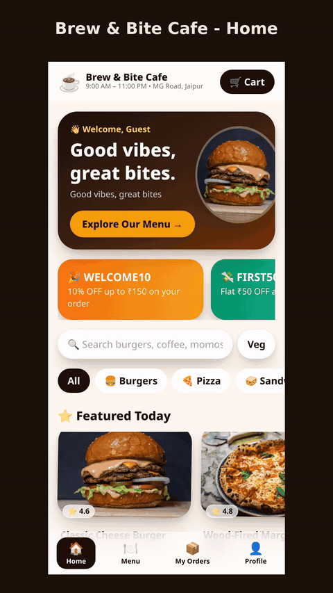
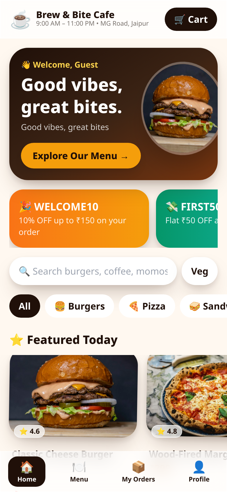
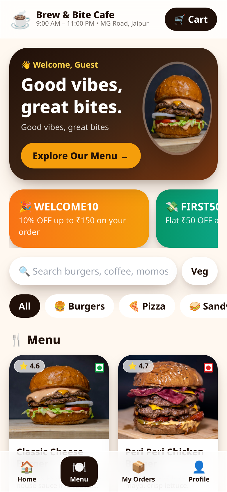
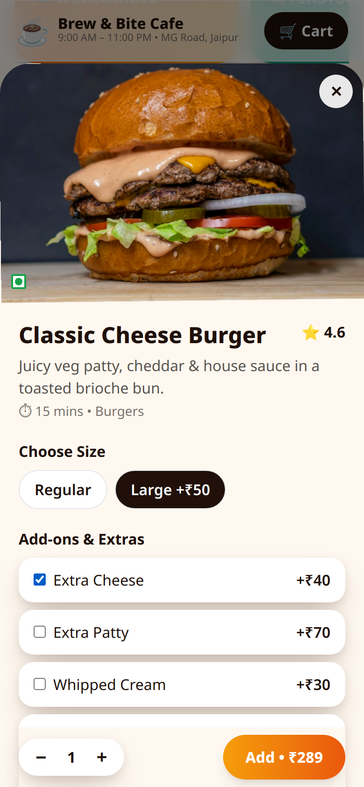
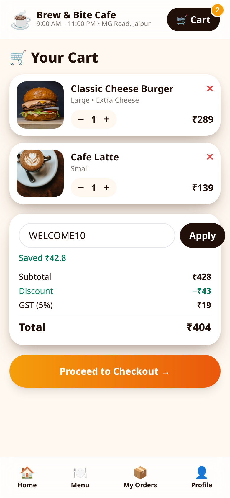
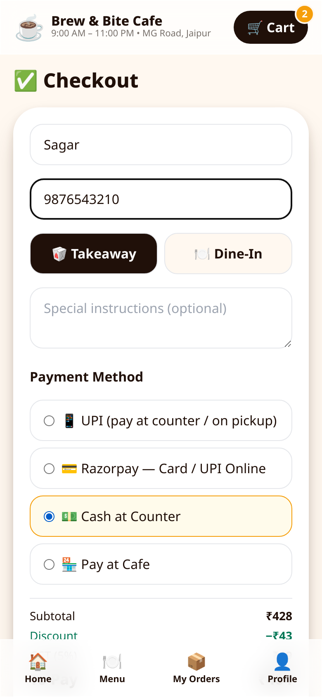
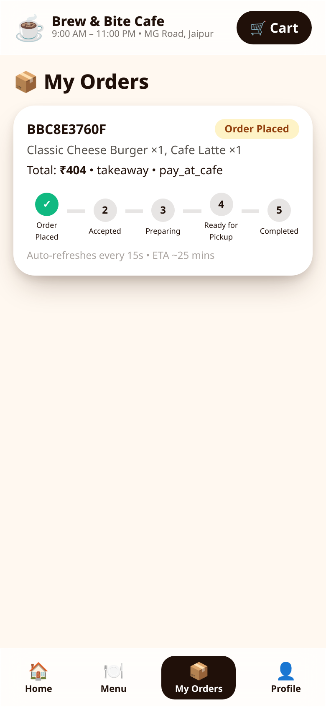
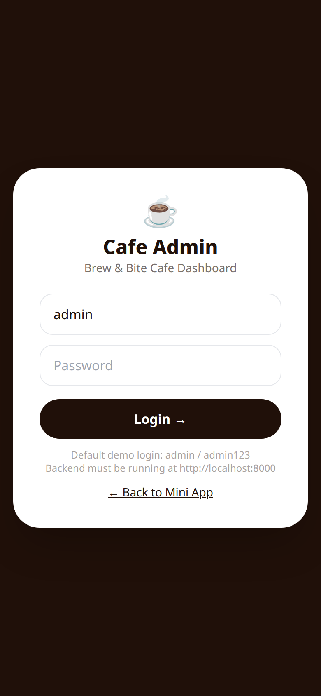

# ☕ Brew & Bite Cafe — 3D Interactive Cafe Food Ordering System (Telegram Mini App)

A production-ready cafe ordering system that lives **inside Telegram**: customers tap **Order Food 🍔** in the bot, a premium Mini App opens in Telegram, they browse a 3D-style menu, customise, pay, and track their order live. The cafe owner manages everything from the admin dashboard.

**Stack:** React + Vite + TypeScript + Tailwind + Framer Motion (Mini App) • FastAPI + SQLAlchemy + Pydantic (backend) • PostgreSQL (prod) / SQLite (zero-setup local) • python-telegram-bot • Razorpay + UPI + Cash

## 🎬 Demo

<p align="center">
  
</p>

Full walkthrough video: [docs/media/demo.mp4](docs/media/demo.mp4) (1080×1920, ~21s)

### Screenshots

| Home | Menu & Categories | Item Detail |
|---|---|---|
|  |  |  |

| Cart (coupon applied) | Checkout | Order Tracking |
|---|---|---|
|  |  |  |

| Admin Login |
|---|
|  |

New orders also post to the cafe's **staff Telegram group** with inline status buttons (Placed → Accepted → Preparing → Ready → Completed) — see [GROUP_FEATURE.md](GROUP_FEATURE.md).

## Project Structure
```
cafe-telegram-miniapp/
├── backend/            FastAPI app (app/main.py), bot (app/bot.py), seed, tests
│   └── app/routers/    public menu, auth, orders, payments, admin
├── frontend/           React Mini App + Admin dashboard (/admin)
├── docker-compose.yml  Postgres + backend + frontend
└── BUILD_REPORT.md     Verification results + honest limitations
```

## Quick Start (Local, 5 steps)
1. **Backend:** `cd backend && python -m venv .venv && source .venv/bin/activate` (Windows: `.venv\Scripts\activate`)
2. `pip install -r requirements.txt && cp .env.example .env`
3. `uvicorn app.main:app --reload --port 8000` → API at http://localhost:8000/health (auto-seeds menu, admin, coupons on first boot; SQLite, no setup needed)
4. **Frontend:** `cd ../frontend && npm install && npm run dev` → http://localhost:5173 (Mini App) and http://localhost:5173/admin (Admin: `admin` / `admin123` — **change before production**)
5. **Bot (optional locally):** put `BOT_TOKEN` + `WEBAPP_URL` in `backend/.env`, then `python -m app.bot`

Or everything at once: `docker compose up --build`

## Environment Variables
| Var | Where | Purpose |
|---|---|---|
| `BOT_TOKEN` | backend | From @BotFather. Used for bot + initData verification. Never commit it. |
| `WEBAPP_URL` | backend/bot | Public HTTPS URL of the deployed frontend (Mini App URL) |
| `GROUP_CHAT_ID` | backend | Telegram staff-group ID for order notifications with status buttons (see below); empty = disabled |
| `DATABASE_URL` | backend | PostgreSQL URL in prod; empty = local SQLite |
| `JWT_SECRET` | backend | Long random secret for user/admin JWTs |
| `DEV_AUTH` | backend | `1` = allow dev guest user when no bot token (local only; set `0` in prod) |
| `RAZORPAY_KEY_ID` / `RAZORPAY_KEY_SECRET` | backend | Razorpay keys; empty = online payment gracefully disabled, Cash/UPI flows work |
| `CORS_ORIGINS` | backend | Comma-separated allowed origins |
| `ADMIN_USERNAME` / `ADMIN_PASSWORD` | backend | Seeded admin (hashed with PBKDF2 in DB) |
| `VITE_API_URL` | frontend | Backend base URL |
| `VITE_RAZORPAY_KEY_ID` | frontend | Razorpay public key for checkout.js |

## Telegram / BotFather Setup
1. Talk to **@BotFather** → `/newbot` → copy the token into `backend/.env` (`BOT_TOKEN`). Never paste the token in chat/code.
2. Deploy the frontend (HTTPS is mandatory for Mini Apps) — see Deployment.
3. Back in BotFather: `/mybots` → your bot → **Bot Settings → Menu Button** → set the Web App URL to your frontend URL. (The bot also sends an inline **Order Food 🍔** WebApp button on `/start` and `/menu`, which works without the menu-button step.)
4. Set `WEBAPP_URL` to the same URL in the backend env and restart the bot: `python -m app.bot`
5. Test on Android, iOS and Telegram Desktop: open the bot → `/start` → tap **Order Food 🍔**.

**Security model:** the Mini App sends Telegram `initData`; the backend verifies its HMAC-SHA256 signature with the bot token before trusting any user id. All prices are **recalculated server-side from the database** — client-sent prices are ignored. Razorpay payments are only marked paid after server-side HMAC signature verification (or webhook).

## How Ordering Works
Menu → product detail (size S/M/L, add-ons, instructions, quantity) → cart (GST + coupon applied by the server) → checkout (name, phone, dine-in + table / takeaway, payment: UPI, Razorpay, Cash at Counter, Pay at Cafe) → order confirmation in-app (+ Telegram message when the bot is running) → live 6-step tracking that auto-refreshes: Placed → Accepted → Preparing → Ready → Completed (or Cancelled), driven by the admin dashboard.

## Staff Group Order Notifications (Telegram group + status buttons)
Every new order is posted to your cafe's staff Telegram group with the full order (items, customisations, totals, customer name/phone, dine-in table or takeaway, payment method + status, ETA) and **inline status buttons**: Order Placed → Accepted → Preparing → Ready for Pickup → Completed, plus ❌ Cancel Order. Passed steps show ✅, the current step shows 🔵. Staff tap a button in the group — no dashboard needed — and everything syncs at once: the group message edits itself, the order status updates in the database, the customer's Mini App tracker moves, and the customer gets a bot DM with the new status. Only forward steps are allowed (cancel works from any non-final state); status changes made in the admin dashboard also edit the group message to match.

**Setup (2 minutes):**
1. Create a Telegram group for cafe staff and add **@Digital_Cafebot** to it.
2. Send `/chatid` in that group — the bot replies with the group's chat ID.
3. Copy that ID into `backend/.env`: `GROUP_CHAT_ID=<the-id>` (it looks like `-1001234567890`).
4. Restart the **backend** (the API reads `GROUP_CHAT_ID` from `backend/.env`) and restart the **bot** too.
5. Place a test order from the Mini App — the notification with buttons should appear in the group. Tap **Accepted** and watch the message, the customer tracker and the admin dashboard all update.

**Troubleshooting — orders show in the admin panel but nothing arrives in the group:** check the backend's startup log. On every boot it prints one line: `notify config: BOT_TOKEN set=YES, GROUP_CHAT_ID set=YES` (booleans only — no secret values). That line must show `GROUP_CHAT_ID set=YES`. If it shows `NO`, the value is missing at runtime: either it was put in the **project-root** `.env` instead of **`backend/.env`** (the file in the same folder as the backend code — that is the one the API reads), or the backend was not **fully restarted** after editing `.env` (saving the file alone does not reload it; stop uvicorn completely and start it again). Fix the file/restart, confirm the startup line flips to `YES`, then place a new test order — older orders are not re-sent.

Notes: notifications are best-effort — if Telegram is unreachable or `GROUP_CHAT_ID` is empty, orders still place normally. The bot process reads `BOT_TOKEN`/`WEBAPP_URL` from `backend/.env` (via `app.config`, same as the API); a value set in the terminal session still wins over `.env`. It does **not** need `GROUP_CHAT_ID` — button taps arrive as callback queries with the group message attached, and the bot writes the new status to the same database the API uses.

## Admin Dashboard (`/admin`)
Login (JWT + role) → overview stats (total/today orders, revenue, pending, completed, popular items, recent transactions) • food CRUD + availability toggle • category CRUD • order management with status changes + printable receipt • coupons • tables • inventory with low-stock flags • sales report by day • settings (cafe info, hours, GST % — GST feeds the server-side price calculation).

## 3D Presentation — Design Choice
List items deliberately avoid heavy WebGL: they use high-resolution food photography with CSS 3D transforms (perspective tilt), layered realistic shadows, floating animation and a rotating CSS-3D featured-dish hero. This keeps the Mini App fast on average mobile connections (the spec's explicit priority) while still feeling 3D. One genuine Three.js scene was intentionally **not** added — it would add ~600 KB to the bundle for decoration only.

## Deployment
- **Frontend → Vercel:** import `frontend/`, set `VITE_API_URL` to your backend URL, deploy. Use its HTTPS URL as `WEBAPP_URL`.
- **Backend → Render/Railway/VPS:** root dir `backend/`, start command `uvicorn app.main:app --host 0.0.0.0 --port $PORT`, set all backend env vars, attach a managed PostgreSQL and set `DATABASE_URL`, set `DEV_AUTH=0`.
- **Images:** seed uses Unsplash URLs; for production uploads use Cloudinary/S3 URLs in the admin food form (image URL field).
- **Backups:** enable automated backups on your managed PostgreSQL.

## Tests
`cd backend && python -m pytest tests/ -q` — covers initData verification (valid + tampered), server-side pricing (tampered client price ignored), coupon + GST math, order lifecycle transitions, and admin-auth enforcement.

## Default Seed Data
Cafe **Brew & Bite Cafe** • 11 categories • 22 dishes with sizes & add-ons • Coupons `WELCOME10` (10% up to ₹150) & `FIRST50` (₹50 off above ₹299) • 8 tables • GST 5% • Admin `admin`/`admin123` (change before production).
